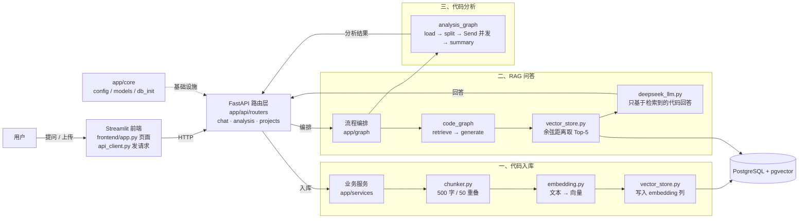

SiftRepo — AI 代码分析与项目问答助手


SiftRepo 是一个基于大语言模型（LLM）与检索增强生成（RAG）的 AI 代码分析与项目问答应用。

用户可以上传 ZIP 格式的代码项目，通过自然语言提问，检索相关源码片段，并结合大语言模型生成具有代码上下文的回答。

项目采用前后端分离架构，后端负责代码处理、向量化、语义检索与问答流程编排，前端提供可视化交互界面。


<p align="center">
  
  
  
  
  
  
</p>---

📑 目录

- "项目功能" (#-项目功能)
- "技术栈" (#-技术栈)
- "系统架构" (#-系统架构)
- "核心流程" (#-核心流程)
- "项目结构" (#-项目结构)
- "环境要求" (#-环境要求)
- "快速开始" (#-快速开始)
- "API 接口" (#-api-接口)
- "测试与评测" (#-测试与评测)
- "技术设计" (#-技术设计)
- "后续计划" (#-后续计划)

---

✨ 项目功能

功能| 说明
📦 代码项目上传| 支持通过 ZIP 压缩包导入代码项目
🔍 代码文件过滤| 根据文件扩展名筛选支持处理的源代码文件
✂️ 代码切分| 使用 "RecursiveCharacterTextSplitter" 将源码拆分为适合检索的文本块
🧠 向量化存储| 使用 Embedding 模型生成代码向量，并存储到 PostgreSQL 的 pgvector 中
🔎 语义检索| 将用户问题转换为向量，检索当前项目中语义相关的代码片段
💬 项目问答| 结合检索结果与大语言模型，根据代码上下文生成回答
🖥️ 可视化交互| 使用 Streamlit 提供项目上传、问题输入和回答展示界面

🛠️ 技术栈


技术| 用途
Python| 主要开发语言
FastAPI| 后端 API 服务
Streamlit| 前端交互界面
LangChain| 文本切分与模型集成
LangGraph| 编排代码问答流程
DeepSeek 兼容接口| 大语言模型调用
OpenAI-compatible Embedding API| 生成文本向量
PostgreSQL| 存储项目、文件及代码块数据
pgvector| 向量存储与相似度检索
Tortoise ORM| 异步数据库操作
Docker| 数据库及开发环境部署

🏗️ 系统架构




🔄 核心流程

1. 代码项目导入

1. 用户上传 ZIP 格式的代码项目。
2. 后端读取压缩包，并筛选支持的源代码文件。
3. 将项目、文件信息及源码保存到数据库。
4. 使用文本切分器将源码拆分为多个代码块。
5. 调用 Embedding 模型，为代码块生成向量。
6. 将代码块及其向量保存到数据库，供后续检索使用。

2. 基于 RAG 的代码问答


1. 用户输入问题，并指定目标项目。
2. Embedding 模型将问题转换为查询向量。
3. 后端通过 pgvector 检索语义相关的代码块。
4. 将检索到的代码片段整理为上下文。
5. LangGraph 组织问答流程，并调用大语言模型生成回答。
6. FastAPI 将回答返回给 Streamlit 前端。
7. 若问题带指代（「它」「那个」），后端会先把上一轮问题拼进检索语句；最近 3 轮问答随请求一起带上（`history`），但只用于理解指代，不作为代码依据。

📁 项目结构

```text
SiftRepo/
├── app/
│   ├── main.py                  # FastAPI 入口：日志、中间件、异常处理、注册 ORM 与路由
│   ├── core/                    # 与业务无关的基础设施
│   │   ├── config.py            # 读取 .env，生成 Tortoise ORM 配置
│   │   ├── models.py            # ORM 表定义：Project / CodeFile / CodeChunk
│   │   └── db_init.py           # 幂等初始化 pgvector 扩展与 embedding 向量列
│   ├── api/                     # HTTP 层：路由只做「收参数 → 调服务 → 返回」
│   │   ├── __init__.py          # api_router：把所有路由拼成一个
│   │   └── routers/
│   │       ├── chat.py          # POST /chat/ 代码问答（支持带 history 多轮）
│   │       ├── analysis.py      # POST /analysis/ 单文件代码分析
│   │       └── projects/
│   │           ├── query.py     # GET /projects、GET /projects/{id}/files
│   │           ├── upload.py    # POST /projects/upload（ZIP → 切块 → 向量化）
│   │           └── limits.py    # 上传上限、目录白名单、批量大小等常量
│   ├── services/                # 业务能力
│   │   ├── chunker.py           # 代码切分（500 字符 / 50 重叠，带行号）
│   │   ├── embedding.py         # 只负责「文本 → 向量」（懒加载客户端）
│   │   ├── vector_store.py      # 向量写库与 pgvector 相似度检索（raw SQL）
│   │   ├── deepseek_llm.py      # 大模型客户端
│   │   ├── file_filter.py       # 支持的代码/文档/配置文件后缀
│   │   └── code_chunk_analysis.py  # 代码块分析（Send 并发）与汇总
│   ├── model/                   # 跨层数据契约（Pydantic，与 core/models.py 的 ORM 表分工）
│   │   ├── api.py               # 请求体：ChatRequest / HistoryTurn / AnalysisRequest
│   │   ├── state.py             # 图的 state：OverAllState / AnalysesState
│   │   └── analysis.py          # 分析结果：AnalysisResult / AnalysisIssue
│   ├── graph/                   # 流程编排：节点、建图
│   │   ├── nodes/               # 一个节点一个文件，只放函数
│   │   │   ├── query_builder.py # 多轮：指代补全 + 历史压缩（纯确定性）
│   │   │   ├── retrieve.py      # retrieve_node：检索项目代码块
│   │   │   ├── generate.py      # generate_node：只依据检索结果作答
│   │   │   ├── load_file.py     # load_file：按 file_id 取文件
│   │   │   ├── split.py         # split_node：切分成待分析块
│   │   │   ├── analyze_chunk.py # analyses_code_chunk_node：单块分析
│   │   │   ├── summary.py       # summary_analyses_node：多块汇总
│   │   │   └── empty_result.py  # empty_result_node：空文件兜底
│   │   └── build.py             # 建图 + compile：graph / analyses_graph
├── frontend/
│   ├── app.py                   # Streamlit 页面：只负责渲染与交互
│   └── api_client.py            # 前端 HTTP 层：所有请求都从这里发
├── scripts/                     # 一键启动与自检脚本
│   ├── run_backend.ps1
│   ├── run_frontend.ps1
│   └── check_files.py           # 打印最近入库的文件（手工排查用）
├── tests/                       # pytest 冒烟测试
├── docker-compose.yml           # PostgreSQL + pgvector
├── .env.example
├── pytest.ini
├── requirements.txt             # 直接依赖
└── requirements-lock.txt        # 锁定版本
```

💻 环境要求

- Python 3.11 及以上（开发和验证使用 3.11.16）
- PostgreSQL 16 + pgvector（`docker-compose.yml` 已使用 `pgvector/pgvector:pg16` 镜像）
- 可访问的大语言模型 API
- 可访问的 Embedding API
- Docker（如果使用 Docker 启动数据库）

🚀 快速开始

1. 获取项目

git clone https://github.com/danlegeding/SiftRepo.git
cd SiftRepo

2. 创建 Python 环境

使用 Conda 创建并激活环境：

conda create -n SiftRepo python=3.13
conda activate SiftRepo

如果已有可用的 Python 环境，也可以直接使用。

3. 安装依赖

python -m pip install -r requirements.txt

4. 配置环境变量

在项目根目录创建 ".env" 文件，并根据实际使用的模型服务和数据库配置填写环境变量。

Embedding 服务使用的环境变量包括：

CLOSEAI_API_KEY=你的Embedding_API密钥
CLOSEAI_BASE_URL=你的Embedding_API地址

此外，还需要根据项目实际配置填写数据库连接信息，以及大语言模型所需的 API 密钥、接口地址和模型名称。

«⚠️ 安全提示： 请勿将包含真实 API Key、数据库密码等敏感信息的 ".env" 文件提交到 GitHub。»

5. 启动数据库

先在 `docker-compose.yml` 所在目录启动 PostgreSQL：

```bash
docker compose up -d
```

`docker-compose.yml` 使用 `pgvector/pgvector:pg16` 镜像，数据库名 `siftrepo`、用户 `user`、端口 `5432`（默认密码见 compose 文件，`.env` 里的 `DB_URL` 必须与之一致）。

pgvector 扩展与 `codechunk.embedding` 向量列**不需要手工创建**：应用首次写入或检索向量时，`app/db_init.py` 会执行幂等的 `CREATE EXTENSION IF NOT EXISTS vector` 与 `ALTER TABLE ... ADD COLUMN IF NOT EXISTS` 自动补齐。

6. 启动后端

在项目根目录执行：

python -m uvicorn app.main:app --host 127.0.0.1 --port 8000

后端启动后，可以通过以下地址查看交互式 API 文档：

"http://127.0.0.1:8000/docs" (http://127.0.0.1:8000/docs)

7. 启动前端

打开另一个终端，在项目根目录执行：

python -m streamlit run frontend/app.py

启动成功后，根据终端显示的 Local URL 打开前端页面。

默认情况下，前端请求的后端地址为：

http://127.0.0.1:8000

如果后端地址发生变化，请同步调整前端的 "SIFTREPO_API_URL" 配置。

🔌 API 接口

接口列表

请求方法| 接口路径| 功能
"POST"| "/projects/upload"| 上传并处理代码项目
"GET"| "/projects"| 列出项目（id、名称、文件数、代码块数）
"GET"| "/projects/{project_id}/files"| 列出项目下的文件与代码块起止行
"POST"| "/chat/"| 对指定项目进行自然语言问答
"POST"| "/analysis/"| 对单个文件做代码分析
"GET"| "/docs"| 查看交互式 API 文档

项目问答示例

请求路径

POST /chat/

请求体

{
  "question": "这个项目的入口文件在哪里？",
  "project_id": 17,
  "history": []
}

响应体

{
  "answer": "这里返回基于检索到的代码上下文生成的回答。",
  "retrieval_query": "实际用于检索的查询（指代补全后）"
}

其中，`project_id` 需替换为 upload 接口实际返回的 ID。

多轮追问（可选）

`history` 传最近几轮问答（最多 6 轮）：

1. 当前问题含「它 / 那个 / 刚才」这类指代、或问题过短时，后端会把上一轮问题拼进检索查询，避免检索到无关代码；
2. 最近 3 轮问答会作为「对话上下文」拼进生成提示词（只用于理解指代，不作为代码依据）。

{
  "question": "那它的超时呢",
  "project_id": 17,
  "history": [
    {"question": "登录逻辑在哪个文件？", "answer": "在 app/routers/auth.py 的 login()。"}
  ]
}

前端已自动带上最近 3 轮；`history` 不落库（本轮不引入 thread_id / checkpointer）。

⚠️ 注意：上传接口会先落库项目、文件与代码块，再批量生成向量。若向量写入失败，接口会返回 500 并回滚清理已写入的记录，重新上传即可（不会产生重复项目）。

🧪 测试与评测

**自动化测试（30 个用例，CI 全绿）**

```bash
pip install -r requirements.txt -r requirements-dev.txt
pytest -q          # 30 passed
```

| 测试文件 | 用例数 | 覆盖内容 |
|---|---|---|
| `tests/test_chunker.py` | 4 | 代码切分块大小、重叠、起始行号 |
| `tests/test_file_filter.py` | 3 | 后缀白名单与目录过滤 |
| `tests/test_models.py` | 5 | ORM 字段契约、`embedding` 列由 SQL 补 |
| `tests/test_retrieval_query.py` | 8 | 多轮指代补全、历史截断 |
| `tests/test_api_contract.py` | 10 | openapi 路径集合、参数校验（422）、404、stub 检索+LLM 的问答链路 |

CI 见 `.github/workflows/ci.yml`：GitHub Actions + `pgvector/pgvector:pg16` service 容器，跑 `compileall` + `pytest`；LLM 与 embedding 在测试里全部 stub，不消耗额度。

**效果评测（`scripts/`，需要真实模型，不在 CI 里跑）**

| 指标 | 脚本 | 结果 | 口径 |
|---|---|---|---|
| 检索 hit@1 / hit@3 / hit@5 / MRR | `run_retrieval_eval.py` | 0.40 / 0.67 / 0.73 / 0.54（15 题） | 期望文件是否出现在 top-k |
| 检索耗时 P50 | 同上 | 495 ms | embedding + 检索，不含 LLM |
| 引用真实性（严格） | `run_answer_eval.py` | 0.42（24 条引用） | 回答里的**完整路径**能在检索上下文里找到 |
| 引用真实性（宽松） | 同上 | 1.00 | 只写文件名也算（文件确实来自检索结果） |
| 编造文件率 | 同上 | 0.00 | 引用项目里根本不存在的文件 |
| 边界拒答率 | 同上 | 1.00（5 题） | 问库里没有的东西时明确说找不到 |

已知不足：模型习惯只写文件名（`build.py`）而不是完整相对路径（`app/graph/build.py`），所以严格口径只有 0.42——这不是编造（编造率为 0），而是引用写法不完整；把 prompt 里的引用要求改成「必须写完整相对路径」可以进一步提升该指标，属于后续对照实验。

🗺️ 技术设计

为什么使用 RAG？

直接将整个代码项目交给大语言模型，会受到上下文长度、调用成本和信息相关性等因素限制。

本项目先将源码切分并建立向量索引，再根据用户问题检索相关代码片段，让模型基于更有针对性的上下文生成回答。

为什么使用 LangGraph？

LangGraph 用于组织问答流程中的状态和节点，使检索、上下文处理和回答生成等步骤具有明确的执行关系，同时为后续扩展多步骤代码分析能力提供基础。

为什么使用 PostgreSQL 和 pgvector？

PostgreSQL 可以统一存储项目、文件和代码块等结构化数据，pgvector 则提供向量存储和相似度检索能力。

对于当前项目规模，这种组合能够减少额外引入独立向量数据库带来的部署与维护成本。

🗺️ 后续计划

- [x] 增加自动化测试，覆盖上传、切分、检索和问答流程（30 个用例 + CI）。
- [x] 优化检索结果的相关性，并评估不同检索策略的效果（hit@5 = 0.73，见上文评测表）。
- [ ] 处理「中文问题更容易命中中文文档」：给代码文件加权或加重（R03/R04/R15 三个未命中都属于这类）。
- [ ] 把 prompt 里的引用要求改成「必须写完整相对路径」，把严格口径的引用真实性从 0.42 提上去。
- [ ] 支持更多编程语言和代码文件类型。
- [ ] 改进跨文件调用关系分析能力。
- [ ] 在前端展示检索结果对应的文件路径和代码行号。
- [ ] 完善 Docker Compose 部署流程和项目使用文档。

📌 项目说明

SiftRepo 是一个用于学习和实践 AI 应用开发的项目，主要探索大语言模型、Embedding、RAG、向量检索与工作流编排在代码理解场景中的应用。

项目重点是构建从代码导入、索引建立到语义检索与问答的完整应用流程。
